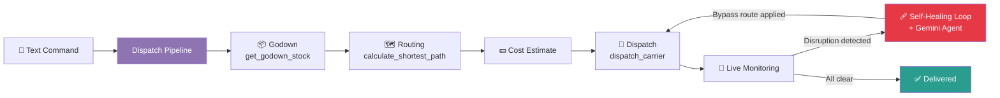
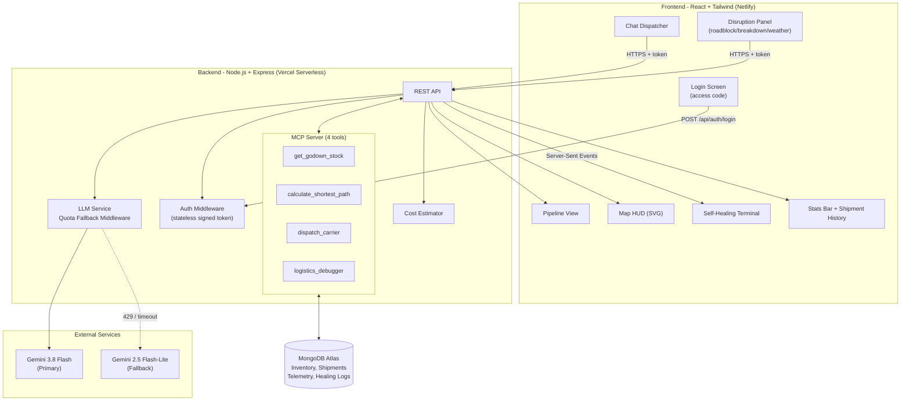
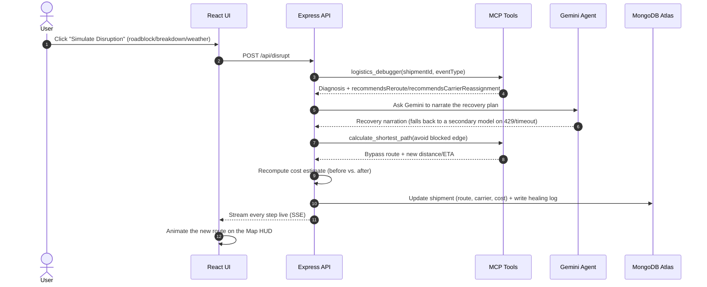
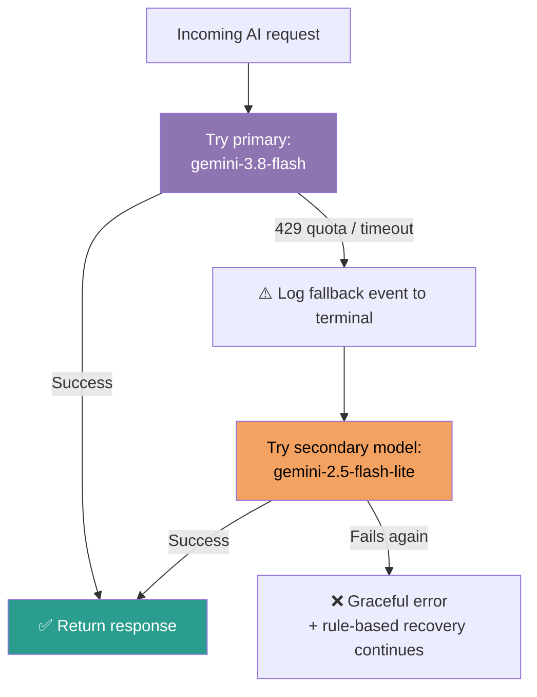
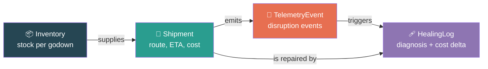

<div align="center">

# 🚚 AutoRoute AI

### A Conversational, Self-Healing Autonomous Supply Chain OS

**Type an order. Watch it ship. Watch it fix itself when things break.**


[💡 Solution](#-our-solution) · [🏗️ Architecture](#%EF%B8%8F-system-architecture) · [🩹 Self-Healing](#-the-self-healing-loop-our-winning-feature) · [🚀 Quick Start](#-quick-start)

</div>

---

## 🔑 Reviewer Access

- **Live app:** https://logitechs.netlify.app/
- **Backend API:** https://a2-v-logistics.vercel.app/ (`/api/health` to check it's up)
- **Access code to log in:** `autoroute2026`

No username — just enter the code on the login screen. See [`SETUP.md`](./SETUP.md) for full local setup, run, and test instructions.

---

## 📑 Table of Contents

1. [The Problem](#-the-problem)
2. [Our Solution](#-our-solution)
3. [Key Features](#-key-features)
4. [How It Works](#-how-it-works)
5. [System Architecture](#%EF%B8%8F-system-architecture)
6. [The Self-Healing Loop](#-the-self-healing-loop-our-winning-feature)
7. [MCP Server and Tools](#-mcp-server-and-tools)
8. [Multi-Model Quota Fallback](#-multi-model-quota-fallback)
9. [Tech Stack](#%EF%B8%8F-tech-stack)
10. [Project Structure](#-project-structure)
11. [Database Schema](#%EF%B8%8F-database-schema)
12. [API Reference](#-api-reference)
13. [Quick Start](#-quick-start)
14. [Deployment](#-deployment)
15. [Demo Script](#-demo-script)
16. [Roadmap](#%EF%B8%8F-roadmap)
17. [Team](#-team)

---

## ❗ The Problem

Modern logistics is **fragile and manual**. A single roadblock, vehicle breakdown or stock delay forces a human dispatcher to:

- notice the problem late,
- diagnose it by hand,
- find an alternate route or godown,
- update several disconnected systems,
- and inform everyone involved.

Every minute lost means missed SLAs, unhappy customers and higher cost. Existing tools **track** shipments but do not **think and act**.

## 💡 Our Solution

**AutoRoute AI** is an end-to-end conversational dispatcher that manages goods through the full pipeline:

```
Godown  →  Packaging  →  Transit  →  Shipping
```

You type a **text command**. An AI agent runs the whole pipeline through **MCP tools**. When something goes wrong, the system **detects, diagnoses and fixes itself in real time, with no human intervention**, and shows you exactly what it did in a live log.

> 💬 *"Ship 200 units from Godown A to Port 1."*
> That one sentence triggers stock verification, route calculation, cost estimation, and carrier dispatch.

---

## ✨ Key Features

| # | Feature | What it does |
|---|---------|--------------|
| 1 | 💬 **Conversational Dispatcher** | Type a natural-language order; quick-command chips for common ones. |
| 2 | 🔗 **End-to-End Pipeline View** | Animated steps: Godown → Packaging → Routing → Dispatch. |
| 3 | 🧩 **MCP Server Architecture** | Backend exposes exactly 4 explicit, auditable tools the agent calls. |
| 4 | 🩹 **Self-Healing Feedback Loop** | Inject roadblock/breakdown/weather and the agent diagnoses, reroutes, and updates the DB live. |
| 5 | 🗺️ **Interactive Map HUD** | SVG node graph with an animated route draw-in and a traveling vehicle marker. |
| 6 | 🛡️ **Multi-Model Quota Fallback** | If Gemini hits a 429 or timeout, the session transparently switches to a backup model. |
| 7 | 🖥️ **Live Terminal Logs** | Watch the agent's reasoning and tool calls stream in real time (via SSE). |
| 8 | 💵 **Cost Estimation** | Every dispatch and reroute computes a transparent shipping cost, with before/after comparison on a self-heal. |
| 9 | 🔐 **Single Access-Code Login** | A lightweight, stateless-token gate in front of the whole app. |

---

## 🔄 How It Works



### Step-by-step

1. **📦 Godown (Inventory)**: the pipeline calls `get_godown_stock` to verify enough units are available.
2. **🗺️ Routing**: it calls `calculate_shortest_path` (Dijkstra over a logistics network graph — a stand-in for the real Google Maps Directions API) to pick the fastest route.
3. **💵 Cost estimate**: a transparent cost (base fee + per-km + per-unit) is computed for the route.
4. **🚛 Dispatch**: it calls `dispatch_carrier` to assign a carrier and persist the shipment.
5. **🩹 Self-healing**: if a disruption (roadblock, breakdown, or weather) is reported, `logistics_debugger` diagnoses it, Gemini narrates the recovery plan, a bypass route and new cost are computed, and the shipment is updated automatically (see below).

---

## 🏗️ System Architecture



---

## 🩹 The Self-Healing Loop (Our Winning Feature)

When the user clicks **"Simulate Disruption"** (roadblock, vehicle breakdown or stock delay), this is what happens:



### The loop in four words: **Detect → Diagnose → Decide → Deploy**

| Phase | What happens |
|-------|--------------|
| **Detect** | A disruption (roadblock, breakdown, or weather) is simulated via the Disruption Panel. |
| **Diagnose** | `logistics_debugger` identifies the root cause and, for a breakdown, flags a carrier reassignment. |
| **Decide** | The Gemini agent narrates the recovery plan; `calculate_shortest_path` computes a bypass route excluding the blocked edge. |
| **Deploy** | The shipment, its route, and its cost estimate are updated in MongoDB; the terminal and map update live. |

---

## 🧩 MCP Server and Tools

The backend is structured as a **Model Context Protocol (MCP) server** exposing exactly four tools. The AI never touches the database directly — it can only act through these:

| Tool | Purpose | Input | Output |
|------|---------|-------|--------|
| `get_godown_stock` | Check inventory at a godown before dispatch | `godownId` | `stock`, `capacity` |
| `calculate_shortest_path` | Shortest route via Dijkstra over the logistics network (Maps API is simulated, not live) | `origin`, `destination`, `blockedEdges[]` | `route`, `distanceKm`, `etaMinutes` |
| `dispatch_carrier` | Assign a carrier and persist the shipment | `shipmentId`, `originGodownId`, `destination`, `units`, `route`, `etaMinutes`, `distanceKm`, `costEstimate` | Dispatch confirmation |
| `logistics_debugger` | Diagnose a disruption (roadblock/breakdown/weather) | `shipmentId`, `eventType`, `description` | `diagnosis`, `recommendsReroute`, `recommendsCarrierReassignment` |

> 💡 **Why MCP?** It gives the agent a clean, standardized, secure interface to real system actions, so every decision is traceable and every tool is replaceable.

---

## 🛡️ Multi-Model Quota Fallback

LLM rate limits must not break a live logistics session. Our **LLM service layer** retries transparently:



- ✅ Session state is preserved, so the user notices nothing.
- ✅ Every fallback is logged to the terminal and to the UI log panel.
- ✅ The primary and secondary models are configurable through environment variables.

---

## 🛠️ Tech Stack

| Layer | Technology | Hosting |
|-------|------------|---------|
| **Frontend** | React (Vite), Tailwind CSS, Lucide Icons, Framer Motion | Netlify |
| **Backend** | Node.js, Express.js (REST API + MCP endpoints) | Vercel (serverless) |
| **Database** | MongoDB Atlas (Mongoose) | Atlas Cloud |
| **AI** | Google Gemini API (`gemini-3.8-flash` primary, `gemini-2.5-flash-lite` fallback) | Google |
| **Routing** | Dijkstra's algorithm over a simulated logistics graph (not the live Google Maps API) | Backend |
| **Auth** | Stateless HMAC-signed token, single access code | Backend |
| **Protocol** | Model Context Protocol (MCP) — 4 tools | Backend |

---

## 📁 Project Structure

```
A2V-Logistics/
│
├── client/                         # React SPA (Vite, deployed on Netlify)
│   ├── src/
│   │   ├── components/
│   │   │   ├── LoginScreen.jsx           # Single access-code login
│   │   │   ├── Dashboard.jsx             # Main app shell
│   │   │   ├── ChatDispatcher.jsx        # Conversational order input
│   │   │   ├── PipelineView.jsx          # Godown → Packaging → Routing → Dispatch
│   │   │   ├── MapHUD.jsx                # SVG map, animated route, vehicle marker
│   │   │   ├── TerminalLog.jsx           # Live self-healing/pipeline log (SSE)
│   │   │   ├── DisruptionButton.jsx      # Roadblock / breakdown / weather panel
│   │   │   ├── StatsBar.jsx              # Live KPI tiles (incl. total cost)
│   │   │   ├── ShipmentHistory.jsx       # Status-badged shipment list
│   │   │   └── Toaster.jsx               # Toast notifications
│   │   ├── hooks/useLogStream.js
│   │   ├── lib/{api,auth,toast}.js
│   │   ├── App.jsx
│   │   └── main.jsx
│   ├── tailwind.config.js
│   └── package.json
│
├── server/                         # Express + MCP server (deployed on Vercel)
│   ├── api/index.js                      # Vercel serverless entry point
│   ├── db/{connection,models}.js         # MongoDB Atlas connection + schemas
│   ├── mcp/{server,tools}.js             # MCP tool definitions + invocation
│   ├── routes/{auth,dispatch,disrupt,shipments,logs,mcp,authMiddleware}.js
│   ├── services/
│   │   ├── llmService.js                 # Gemini + quota fallback middleware
│   │   ├── dispatchService.js            # Order parsing + pipeline orchestration
│   │   ├── healingService.js             # Self-healing feedback loop
│   │   ├── routingService.js             # Dijkstra shortest-path (simulated map)
│   │   ├── costService.js                # Shipping cost estimation
│   │   └── authService.js                # Stateless signed-token auth
│   ├── tests/                            # Jest + Supertest (58 tests)
│   ├── index.js                          # Local dev entry point
│   ├── vercel.json
│   └── package.json
│
├── netlify.toml
├── README.md, SETUP.md, PROJECT_IDEA.md, ACTION_PLAN.md
└── .gitignore
```

---

## 🗄️ Database Schema

### Relationships



### Collections (`server/db/models.js`)

**`Inventory`**: `godownId`, `name`, `location`, `stock`, `capacity`

**`Shipment`**: `shipmentId`, `originGodownId`, `destination`, `units`, `status` (`pending`/`packaging`/`in_transit`/`rerouting`/`dispatched`/`delivered`/`failed`), `route[]`, `currentPosition`, `carrier`, `etaMinutes`, `distanceKm`, `costEstimate`

**`TelemetryEvent`**: `shipmentId`, `type` (`roadblock`/`breakdown`/`weather`/`other`), `description`, `location`, `resolved`

**`HealingLog`**: `shipmentId`, `steps[]` (actor + message, for the terminal replay), `diagnosis`, `newRoute[]`, `modelUsed`, `fallbackTriggered`, `outcome` (`healed`/`failed`/`in_progress`), `costBefore`, `costAfter`

---

## 🔌 API Reference

| Method | Endpoint | Auth required | Description |
|--------|----------|:---:|-------------|
| `GET` | `/api/health` | No | Health check |
| `POST` | `/api/auth/login` | No | Exchange an access code for a signed token |
| `POST` | `/api/dispatch` | Yes | Parse a natural-language order and run the full pipeline |
| `POST` | `/api/disrupt` | Yes | Simulate a disruption and trigger the self-healing loop |
| `GET` | `/api/shipments` | Yes | List all shipments |
| `GET` | `/api/shipments/inventory` | Yes | List godown inventory |
| `GET` | `/api/shipments/healing-logs` | Yes | History of self-healing events |
| `GET` | `/api/logs/stream` | Yes (token via `?token=`) | SSE stream of live pipeline/healing logs |
| `GET` | `/api/mcp/tools` | Yes | List the 4 MCP tool specs |
| `POST` | `/api/mcp/tools/:name/invoke` | Yes | Invoke an MCP tool directly |

---

## 🚀 Quick Start

### Prerequisites

- Node.js 18 or later
- A MongoDB Atlas cluster (free tier works)
- A Google Gemini API key (plus an optional backup key)
- A Google Maps API key (optional, simulation mode works without it)
- A Chromium-based browser (best Web Speech API support)

> ℹ️ The actual repo folders are `server/` (backend) and `client/` (frontend) — not `backend/`/`frontend/` as in the diagram above. Full, accurate setup/run/test commands are in **[`SETUP.md`](./SETUP.md)**; the short version:

### 1. Clone the repository

```bash
git clone https://github.com/vicky-510/A2V-Logistics.git
cd A2V-Logistics
```

### 2. Configure environment variables

```bash
cd server
cp .env.example .env   # fill in MongoDB URI, Gemini keys, APP_ACCESS_CODE, AUTH_TOKEN_SECRET
```

### 3. Run the backend

```bash
cd server
npm install
npm run dev       # http://localhost:5000
npm run seed      # optional: demo inventory + a sample shipment
```

### 4. Run the frontend

```bash
cd client
npm install
npm run dev       # http://localhost:5173
```

Open **http://localhost:5173**, log in with your `APP_ACCESS_CODE`, and try:

> *"Ship 200 units from Godown A to Port 1"*

### 5. Run the tests

```bash
cd server && npm test   # Jest — backend
cd client && npm test   # Vitest — frontend
```

---

## ☁️ Deployment

| Part | Platform | Config file | Notes |
|------|----------|-------------|-------|
| Frontend | **Netlify** | `netlify.toml` | Build: `npm run build`, publish: `dist`, proxies `/api/*` to Vercel |
| Backend | **Vercel** | `server/vercel.json` | Root Directory must be `server`, Framework Preset `Other`. Add all env vars (see `.env.example`) in the Vercel dashboard |
| Database | **MongoDB Atlas** | n/a | Allow Vercel's IPs (or `0.0.0.0/0` for the demo) |

See [`SETUP.md`](./SETUP.md) for the full deployment walkthrough and troubleshooting notes.

---

---

## 👥 Team

- **Vigneshwaran M**
- **Abijith UK**
- **Asvika**


---

<div align="center">

</div>
