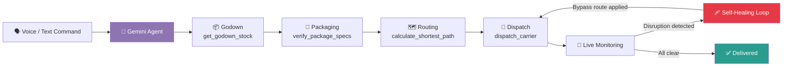
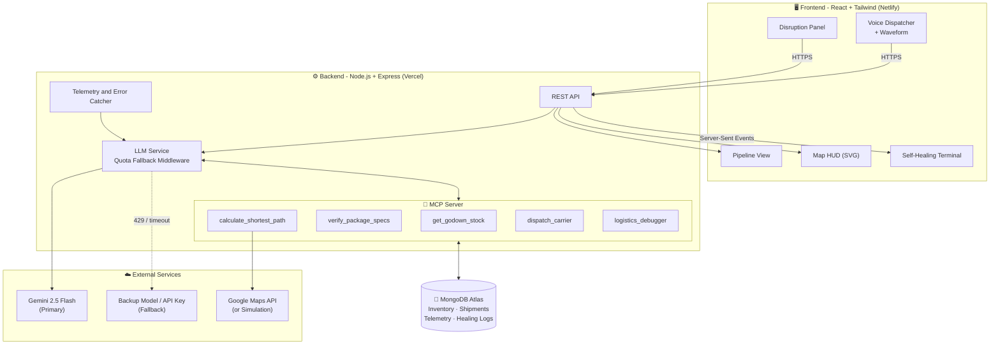
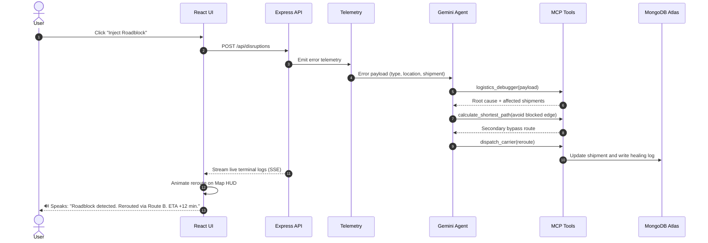
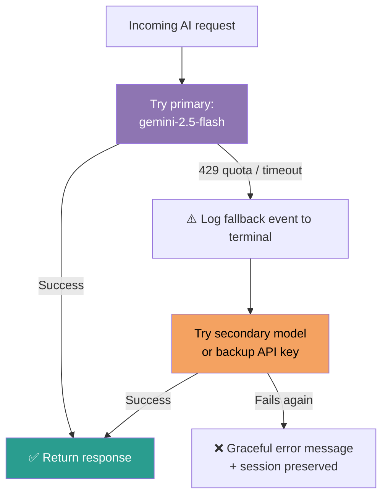
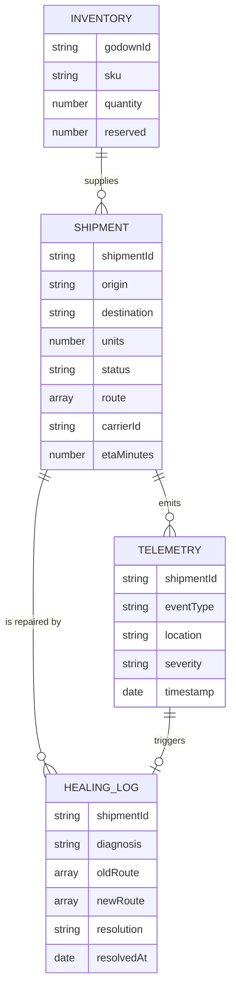

<div align="center">

# 🚚 AutoRoute AI

### A Conversational, Self-Healing Autonomous Supply Chain OS

**Speak an order. Watch it ship. Watch it fix itself when things break.**


[💡 Solution](#-our-solution) · [🏗️ Architecture](#%EF%B8%8F-system-architecture) · [🩹 Self-Healing](#-the-self-healing-loop-our-winning-feature) · [🚀 Quick Start](#-quick-start)

</div>

---

## 📑 Table of Contents

1. [The Problem](#-the-problem)
2. [Our Solution](#-our-solution)
3. [Key Features](#-key-features)
4. [How It Works](#-how-it-works)
5. [System Architecture](#%EF%B8%8F-system-architecture)
6. [The Self-Healing Loop](#-the-self-healing-loop-our-winning-feature)
7. [MCP Server and Tools](#-mcp-server-and-tools)
8. [Multi-Model Quota Fallback](#-multi-model-quota-fallback)
9. [Tech Stack](#%EF%B8%8F-tech-stack)
10. [Project Structure](#-project-structure)
11. [Database Schema](#%EF%B8%8F-database-schema)
12. [API Reference](#-api-reference)
13. [Quick Start](#-quick-start)
14. [Deployment](#-deployment)
15. [Demo Script](#-demo-script)
16. [Roadmap](#%EF%B8%8F-roadmap)
17. [Team](#-team)

---

## ❗ The Problem

Modern logistics is **fragile and manual**. A single roadblock, vehicle breakdown or stock delay forces a human dispatcher to:

- notice the problem late,
- diagnose it by hand,
- find an alternate route or godown,
- update several disconnected systems,
- and inform everyone involved.

Every minute lost means missed SLAs, unhappy customers and higher cost. Existing tools **track** shipments but do not **think and act**.

## 💡 Our Solution

**AutoRoute AI** is an end-to-end conversational dispatcher that manages goods through the full pipeline:

```
Godown  →  Packaging  →  Transit  →  Shipping
```

You give a **voice or text command**. An AI agent runs the whole pipeline through **MCP tools**. When something goes wrong, the system **detects, diagnoses and fixes itself in real time, with no human intervention**, and tells you what it did.

> 🗣️ *"Ship 500 units from Godown A to Port Terminal 3."*
> That one sentence triggers stock verification, packaging checks, route calculation, carrier dispatch and live monitoring.

---

## ✨ Key Features

| # | Feature | What it does |
|---|---------|--------------|
| 1 | 🎙️ **Voice and Text Dispatcher** | Speak or type natural-language orders. Live audio waveform and speech-to-text transcript. |
| 2 | 🔗 **End-to-End Pipeline View** | Animated steps: Godown → Packaging → Routing → Dispatch. |
| 3 | 🧩 **MCP Server Architecture** | Backend exposes explicit, auditable tools the AI agent calls. |
| 4 | 🩹 **Self-Healing Feedback Loop** | Inject a disruption and the agent diagnoses it, reroutes, updates the DB and speaks the fix. |
| 5 | 🗺️ **Interactive Map HUD** | SVG node graph with live vehicles, traffic bottlenecks and rerouting animations. |
| 6 | 🛡️ **Multi-Model Quota Fallback** | If Gemini hits a 429 or timeout, the session transparently switches to a backup model or key. |
| 7 | 🖥️ **Live Terminal Logs** | Watch the agent's reasoning and tool calls stream in real time. |
| 8 | 🔊 **Voice Feedback** | The resolution is spoken back using speech synthesis. |

---

## 🔄 How It Works



### Step-by-step

1. **📦 Godown (Inventory)**: The agent calls `get_godown_stock` to verify that Godown A has 500 units available.
2. **🎁 Packaging**: The agent calls `verify_package_specs` to check package dimensions, weight and handling rules.
3. **🗺️ Routing**: The agent calls `calculate_shortest_path` (Google Maps API or mock) to pick the fastest, clearest route.
4. **🚛 Dispatch**: The agent calls `dispatch_carrier` to assign a vehicle and start the shipment.
5. **🩹 Self-healing**: If telemetry reports a roadblock, breakdown or stock delay, the agent fixes it automatically (see below).

---

## 🏗️ System Architecture



---

## 🩹 The Self-Healing Loop (Our Winning Feature)

When the user clicks **"Simulate Disruption"** (roadblock, vehicle breakdown or stock delay), this is what happens:



### The loop in four words: **Detect → Diagnose → Decide → Deploy**

| Phase | What happens |
|-------|--------------|
| **Detect** | Simulated telemetry raises a roadblock, breakdown or stock-delay event. |
| **Diagnose** | The Gemini agent calls `logistics_debugger` to find the root cause. |
| **Decide** | The agent computes a bypass route or assigns a secondary godown. |
| **Deploy** | The DB is updated, the map is redrawn and the result is spoken back. |

---

## 🧩 MCP Server and Tools

The backend is structured as a **Model Context Protocol (MCP) server**. The AI never touches the database directly. It can only act through these explicit, auditable tools.

| Tool | Purpose | Input | Output |
|------|---------|-------|--------|
| `get_godown_stock` | Check inventory at a godown | `godownId`, `sku`, `quantity` | Available stock, reserved stock |
| `verify_package_specs` | Validate packaging rules | `sku`, `quantity` | Package count, weight, handling flags |
| `calculate_shortest_path` | Fastest route via Google Maps (or mock) | `origin`, `destination`, `avoid[]` | Route nodes, distance, ETA |
| `dispatch_carrier` | Assign a vehicle and start or reroute a shipment | `shipmentId`, `route`, `carrierId` | Dispatch confirmation |
| `logistics_debugger` | Diagnose a disruption | `errorPayload` | Root cause, impact, suggested fix |

> 💡 **Why MCP?** It gives the agent a clean, standardized, secure interface to real system actions, so every decision is traceable and every tool is replaceable.

---

## 🛡️ Multi-Model Quota Fallback

LLM rate limits must not break a live logistics session. Our **LLM service layer** retries transparently:



- ✅ Session state is preserved, so the user notices nothing.
- ✅ Every fallback is logged to the terminal and to the UI log panel.
- ✅ The primary and secondary models are configurable through environment variables.

---

## 🛠️ Tech Stack

| Layer | Technology | Hosting |
|-------|------------|---------|
| **Frontend** | React.js, Tailwind CSS, Lucide Icons, SVG/Canvas animations | Netlify |
| **Backend** | Node.js, Express.js (REST API + MCP endpoints) | Vercel |
| **Database** | MongoDB Atlas (Mongoose) | Atlas Cloud |
| **AI** | Google Gemini API (`gemini-2.5-flash` + fallback) | Google |
| **Voice** | Web Speech API (recognition and synthesis) | Browser |
| **Maps** | Google Maps Directions API (with simulated mode) | Google |
| **Protocol** | Model Context Protocol (MCP) | Backend |

---

## 📁 Project Structure

```
autoroute-ai/
│
├── frontend/                       # React SPA (deployed on Netlify)
│   ├── public/
│   ├── src/
│   │   ├── components/
│   │   │   ├── VoiceDispatcher.jsx       # Mic + text input
│   │   │   ├── WaveformVisualizer.jsx    # Live audio waveform
│   │   │   ├── PipelineView.jsx          # Godown → Packaging → Route → Dispatch
│   │   │   ├── MapHUD.jsx                # SVG map, vehicles, reroute animation
│   │   │   ├── SelfHealingTerminal.jsx   # Live agent logs
│   │   │   └── DisruptionPanel.jsx       # "Simulate Disruption" controls
│   │   ├── hooks/
│   │   │   ├── useSpeechRecognition.js
│   │   │   └── useSpeechSynthesis.js
│   │   ├── services/api.js
│   │   ├── App.jsx
│   │   └── main.jsx
│   ├── tailwind.config.js
│   ├── package.json
│   └── netlify.toml
│
├── backend/                        # Express + MCP server (deployed on Vercel)
│   ├── config/
│   │   └── db.js                         # MongoDB Atlas connection
│   ├── mcp/
│   │   ├── server.js                     # MCP server setup
│   │   └── tools/
│   │       ├── getGodownStock.js
│   │       ├── verifyPackageSpecs.js
│   │       ├── calculateShortestPath.js
│   │       ├── dispatchCarrier.js
│   │       └── logisticsDebugger.js
│   ├── models/
│   │   ├── Inventory.js
│   │   ├── Shipment.js
│   │   ├── Telemetry.js
│   │   └── HealingLog.js
│   ├── routes/
│   │   ├── dispatch.routes.js
│   │   ├── disruption.routes.js
│   │   └── mcp.routes.js
│   ├── services/
│   │   ├── llmService.js                 # Gemini + quota fallback middleware
│   │   ├── agentService.js               # Agent orchestration loop
│   │   └── telemetryService.js
│   ├── server.js
│   ├── package.json
│   └── vercel.json
│
├── docs/                           # Screenshots, diagrams, demo assets
├── .env.example
├── .gitignore
└── README.md
```

> 📝 *Folder names may differ slightly from the final repo.*

---

## 🗄️ Database Schema



---

## 🔌 API Reference

| Method | Endpoint | Description |
|--------|----------|-------------|
| `POST` | `/api/dispatch` | Send a natural-language order to the agent |
| `GET` | `/api/shipments` | List all live shipments |
| `GET` | `/api/shipments/:id` | Get one shipment and its route |
| `POST` | `/api/disruptions` | Simulate a disruption (roadblock, breakdown, stock delay) |
| `GET` | `/api/logs/stream` | Server-Sent Events stream of live agent logs |
| `GET` | `/api/healing-logs` | History of self-healing events |
| `POST` | `/mcp/tools/:toolName` | Invoke an MCP tool directly |
| `GET` | `/mcp/tools` | List available MCP tools |

---

## 🚀 Quick Start

### Prerequisites

- Node.js 18 or later
- A MongoDB Atlas cluster (free tier works)
- A Google Gemini API key (plus an optional backup key)
- A Google Maps API key (optional, simulation mode works without it)
- A Chromium-based browser (best Web Speech API support)

### 1. Clone the repository

```bash
git clone https://github.com/<your-username>/autoroute-ai.git
cd autoroute-ai
```

### 2. Configure environment variables

Create `backend/.env` from `.env.example`:

```env
# Server
PORT=5000

# Database
MONGODB_URI=mongodb+srv://<user>:<password>@<cluster>.mongodb.net/autoroute

# Gemini
GEMINI_API_KEY=your_primary_key
GEMINI_BACKUP_API_KEY=your_backup_key
GEMINI_PRIMARY_MODEL=gemini-2.5-flash
GEMINI_FALLBACK_MODEL=gemini-2.5-flash-lite

# Maps
GOOGLE_MAPS_API_KEY=your_maps_key
USE_SIMULATED_MAPS=true
```

Create `frontend/.env`:

```env
VITE_API_BASE_URL=http://localhost:5000
```

### 3. Run the backend

```bash
cd backend
npm install
npm run dev
```

### 4. Run the frontend

```bash
cd frontend
npm install
npm run dev
```

Open **http://localhost:5173** and try:

> 🎙️ *"Ship 200 units from Godown A to Port 3."*

---

## ☁️ Deployment

| Part | Platform | Config file | Notes |
|------|----------|-------------|-------|
| Frontend | **Netlify** | `frontend/netlify.toml` | Build: `npm run build`, publish: `dist` |
| Backend | **Vercel** | `backend/vercel.json` | Add all `.env` variables in the Vercel dashboard |
| Database | **MongoDB Atlas** | n/a | Allow Vercel's IPs (or `0.0.0.0/0` for the demo) |

After deployment, set `VITE_API_BASE_URL` in Netlify to your Vercel backend URL.

---


---


---

## 👥 Team

- **Vigneshwaran M**
- **Abijith UK**
- **Asvika**


---

<div align="center">

⭐ **If you like this project, give it a star!** ⭐

</div>
